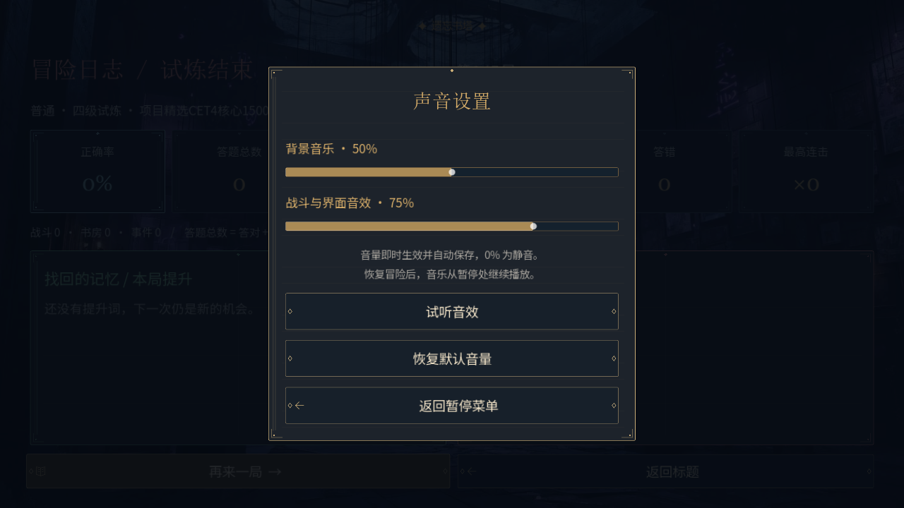
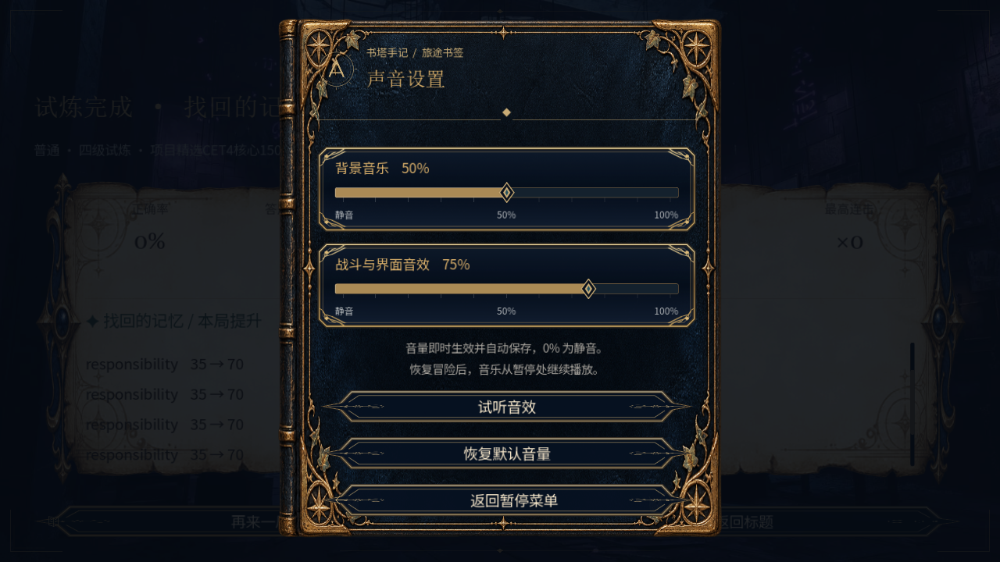
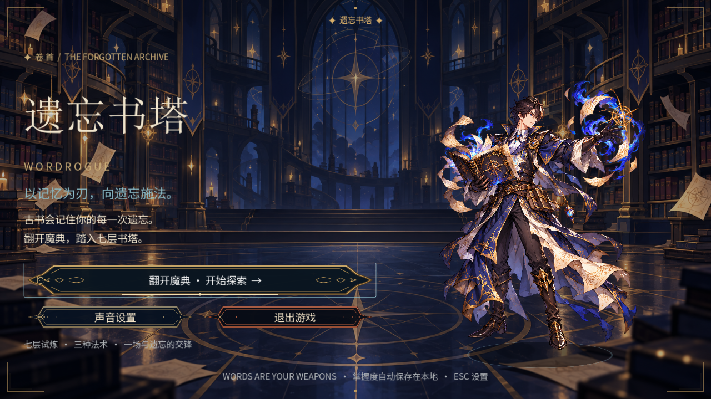
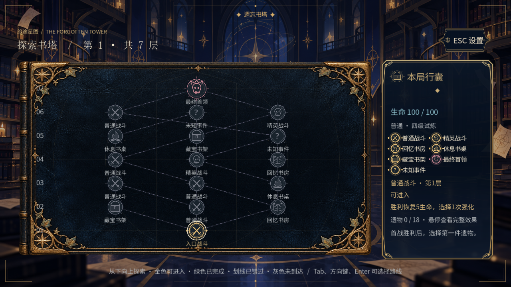
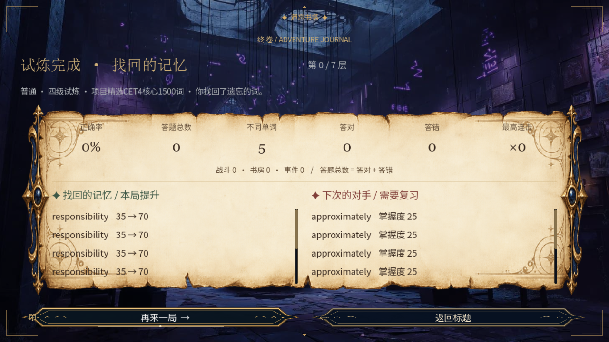

# 当前全流程视觉对照 · 2026-10-26

本轮以已认可的克制标题页统一全流程，当前截图与测试见 [QUIET_FULL_FLOW_REPORT_20261026.md](QUIET_FULL_FLOW_REPORT_20261026.md)，视觉审查见 [quiet_flow_visual_review.md](quiet_flow_visual_review.md)。下文保留旧皮革版本，作为历史对照。

---

# 历史：全流程视觉对照 · 2026-10-23

方向依据与构图规范：[ui-visual-spec.md](ui-visual-spec.md)。原始风格参考：`D:\项目\1\设定参考图\battle_ui_target.png`。全部对照为实际Godot 4.7.2图形窗口捕获。

## 代表性对照

### 设置：灰色面板 → 深蓝皮革魔典与调音铭牌

改造前：

改造后：

### 标题、探索、奖励与日志

日志图为长词压力夹具，数字不是实玩通关结果。正文完整记录：[交付报告](WHOLE_GAME_UI_REPORT_20261023.md)；独立视觉审查：[whole_ui_visual_qa.md](whole_ui_visual_qa.md)。

## 修正轨迹

- Round1：材质和页面语义成立，但底部溢出/雕花压字需修正。
- Round2：35张全流程截图，两种分辨率布局检查通过；审查继续要求事件与长说明避雕花，完整通关暴露日志长词净空问题。
- Final：仅重验受影响页面；紧凑正文边框、奖励说明内缩、独立滚动词单，456项定向检查0失败。视觉结论不由这些计数替代，以独立审核实际打开的截图为准。
